  

<h1 align="center">ToSing</h1>

  sing-box 订阅解析与节点聚合工具

  
  

  <a href="#中文">中文</a> &nbsp;|&nbsp; <a href="#english">English</a>

---

## 中文

### 流程

```mermaid
%%{init: {'theme': 'base', 'themeVariables': { 'primaryColor': '#FFFFFF', 'edgeLabelBackground':'#FFFFFF', 'tertiaryColor': '#FAFAFA'}}}%%
flowchart LR
    classDef input fill:#FAFAFA,stroke:#E4E4E7,stroke-width:1px,color:#27272A,rx:4,ry:4
    classDef box fill:#FFFFFF,stroke:#18181B,stroke-width:1.5px,color:#18181B,rx:6,ry:6
    classDef output fill:#FAFAFA,stroke:#E4E4E7,stroke-width:1px,color:#27272A,rx:4,ry:4

    subgraph Inputs [" 输入格式 "]
        direction TB
        I1["HTTP / HTTPS 订阅链接"]
        I2["Base64 订阅文本"]
        I3["节点链接 (VMess / VLESS / Trojan / SS / Hysteria2 / TUIC / AnyTLS)"]
        I4["Clash / Mihomo 配置 (YAML / JSON)"]
        I5["WireGuard 配置文件 (.conf)"]
    end

    Core["ToSing"]

    subgraph Outputs [" 输出格式 "]
        direction TB
        O1["sing-box 1.11+ 标准出站 (Outbounds)"]
        O2["sing-box 1.11+ 顶层端点 (Endpoints)"]
        O3["标准 JSON 格式"]
    end

    Inputs --> Core --> Outputs

    class I1,I2,I3,I4,I5 input
    class Core box
    class O1,O2,O3 output
```

### 测试数据
基于 36 个异构数据源回放验证：
- **测试样本**：`301,513`
- **解析成功**：`245,717`
- **sing-box 官方内核校验通过**：`245,708`
- **对齐通过率**：**`99.996%`**

---

## English

### Pipeline

```mermaid
%%{init: {'theme': 'base', 'themeVariables': { 'primaryColor': '#FFFFFF', 'edgeLabelBackground':'#FFFFFF', 'tertiaryColor': '#FAFAFA'}}}%%
flowchart LR
    classDef input fill:#FAFAFA,stroke:#E4E4E7,stroke-width:1px,color:#27272A,rx:4,ry:4
    classDef box fill:#FFFFFF,stroke:#18181B,stroke-width:1.5px,color:#18181B,rx:6,ry:6
    classDef output fill:#FAFAFA,stroke:#E4E4E7,stroke-width:1px,color:#27272A,rx:4,ry:4

    subgraph Inputs [" Inputs "]
        direction TB
        I1["HTTP / HTTPS Subscription URLs"]
        I2["Base64 Blobs"]
        I3["Protocol URIs (VMess / VLESS / Trojan / SS / Hysteria2 / TUIC / AnyTLS)"]
        I4["Clash / Mihomo Configs (YAML / JSON)"]
        I5["WireGuard Configs (.conf)"]
    end

    Core["ToSing"]

    subgraph Outputs [" Outputs "]
        direction TB
        O1["sing-box 1.11+ Outbounds"]
        O2["sing-box 1.11+ Top-Level Endpoints"]
        O3["Canonical JSON"]
    end

    Inputs --> Core --> Outputs

    class I1,I2,I3,I4,I5 input
    class Core box
    class O1,O2,O3 output
```

### Validation
Verified against a real-world corpus across 36 heterogeneous sources:
- **Total Records**: `301,513`
- **Parsed**: `245,717`
- **Official Kernel Verified**: `245,708`
- **Pass Rate**: **`99.996%`**
