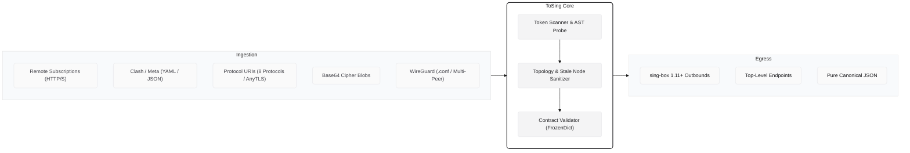
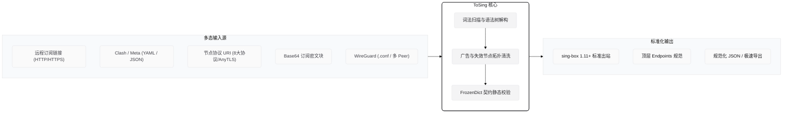

  

<h1 align="center">ToSing</h1>

  <strong>Universal Ingestion. Strict Alignment. Native Speed.</strong> 
  面向下一代 <code>sing-box</code> 内核的高性能无状态通用订阅聚合器与规范化编译器。

  
  
  
  
  
  

  <a href="#english">English</a> &nbsp;|&nbsp; <a href="#中文">简体中文</a>

---

## English

### Pipeline

### Architecture
- **Stateless Pipeline**: Zero runtime database or state leakage. Operates purely in-memory as an idempotent sanitizer and normalizer.
- **Dialect Deconstruction**: Normalizes heterogeneous and malformed URIs/YAML into dialect-agnostic syntax trees, mapping directly to sing-box schema definitions.
- **O(1) Contract Verification**: Uses schemas pre-indexed with `FrozenDictionary` to validate fields, Curve25519 keys, and CIDRs with zero heap linear scans.

### Tech Stack
| Component | Technology | Detail |
| :--- | :--- | :--- |
| **Runtime** | C# 15 / .NET 11 Preview | High-performance, zero-allocation memory layout |
| **Binary** | Native AOT | Single-file standalone executable (~10.6MB CLI, zero runtime dependencies) |
| **Desktop UI** | Avalonia 12.1.2 | Windows 11 Fluent Mica workbench with asynchronous background compute |
| **Data Engine** | Source-Gen `System.Text.Json` | Reflection-free, trim-safe JSON serialization |

### Empirical Validation
Tested against a stress-test corpus of **301,513 real-world network records** across 36 heterogeneous providers:
- **Parsed Outbounds**: `245,717`
- **Official Kernel Validation**: `245,708`
- **Contract Alignment Rate**: **`99.996%`**

### Upstream Commitment
Engineered strictly against the **`sing-box 1.11+` specification** (including top-level `endpoints` architecture and IPv4/IPv6 dual-stack CIDR normalization). Maintained and synchronized with upcoming upstream releases.

---

## 中文

### 处理管线

### 核心原理
- **无状态管道**：全内存运行，零状态残留，纯粹执行幂等数据清洗与拓扑规范化。
- **方言中立语法树**：不论源数据格式差异与畸变，统一解构为协议 AST 并映射至标准数据结构。
- **O(1) 契约静态校验**：通过 `FrozenDictionary` 索引官方 Schema，在纳秒级完成密钥合法性、CIDR 掩码及传输协议判别。

### 技术栈
| 模块 | 核心技术 | 说明 |
| :--- | :--- | :--- |
| **语言与运行时** | C# 15 / .NET 11 Preview | 前沿内存控制与现代语言特性 |
| **机器码交付** | Native AOT | 单文件原生执行档 (~10.6MB CLI，脱机免运行库，毫秒级启动) |
| **桌面工作台** | Avalonia 12.1.2 | Windows 11 Fluent Mica 沉浸卡片、全异步后台与 64KB 极速视口 |
| **序列化** | 源码生成 `System.Text.Json` | 彻底移除反射，全面保障 Native AOT 剪裁安全 |

### 海量实战压测
使用来自 36 个异构数据源的真实节点全景库（含复杂 Clash Meta、Base64 订阅池及多 Peer WireGuard）进行极限回放：
- **实测样本总量**：`301,513`
- **成功解析提取**：`245,717`
- **官方 sing-box 内核校验通过**：`245,708`
- **契约对齐率**：**`99.996%`**

### 上游对齐承诺
严格对齐 **`sing-box 1.11+` 最新规范**（支持顶层 `endpoints` 解构、IPv4/IPv6 双栈规范化与 AnyTLS），并持续跟进官方内核演进。
