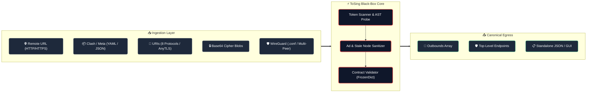
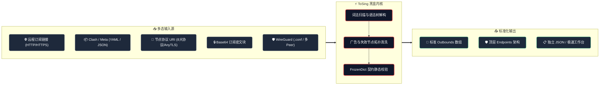

  

<h1 align="center">ToSing</h1>

  <strong>Universal Ingestion. Absolute Normalization. Native Speed.</strong> 
  面向下一代 <code>sing-box</code> 内核的极速通用订阅聚合器与拓扑规范化编译器。

  
  
  
  
  
  

  <a href="#english">English</a> &nbsp;•&nbsp; <a href="#中文">简体中文</a>

---

## 🌐 English

### Black-Box Pipeline

### Architecture & Principles
- **Stateless Pipeline**: Zero runtime database or state leakage. Operates purely in-memory as an idempotent sanitizer and schema normalizer.
- **AST Dialer & Schema Alignment**: Ingests unstructured inputs, decomposes URIs/YAML into dialect-agnostic syntax trees, and maps directly onto sing-box contract definitions.
- **O(1) Contract Verification**: Employs static schemas indexed with `FrozenDictionary` to validate fields, Curve25519 keys, CIDRs, and transport protocols with zero heap-allocated linear scans.

### Tech Stack
| Component | Technology | Role |
| :--- | :--- | :--- |
| **Language & Platform** | C# 15 / .NET 11 Preview | High-performance, memory-safe execution |
| **Compiler & Binary** | Native AOT | Standalone, self-contained single-file executable (~26MB, zero runtime dependencies) |
| **Desktop Workbench** | Avalonia 12.1.2 | Windows 11 Fluent Mica desktop UI with background parallel tasks |
| **Data Engine** | Source-Gen `System.Text.Json` | Zero-reflection serialization fully compatible with AOT trimming |

### Empirical Validation
Stress-tested against **301,513 real-world network records** across 36 heterogeneous sources (Clash Meta, v2ray, Base64 pools, and multi-peer WireGuard configs):
- **Parsed**: `245,717` valid outbounds extracted
- **Official Kernel Verification**: `245,708` passed strict official sing-box check
- **Alignment Pass Rate**: **`99.996%`**

### Upstream Alignment Guarantee
Built strictly to match the latest **`sing-box 1.11+` specification** (including top-level `endpoints`, IPv4/IPv6 dual-stack CIDR masks, and AnyTLS). Continuously synchronized with upstream kernel releases.

---

## 🇨🇳 中文

### 黑盒流转图

### 原理与设计
- **纯粹无状态管道**：无本地数据库与网络状态依赖，全内存执行幂等清洗与语义规范化。
- **语法树与方言中立**：无论来源是混乱的 Base64、非标 Clash 字段还是 URI 参数，均下沉为协议 AST 并重构映射至规范模型。
- **O(1) 契约极速校验**：利用 `FrozenDictionary` 预热官方 Schema，对 Curve25519 密钥、CIDR 掩码、传输层参数进行零分配静态判别。

### 技术栈
| 模块 | 核心技术 | 职责与特性 |
| :--- | :--- | :--- |
| **语言与运行时** | C# 15 / .NET 11 Preview | 前沿语法与极致内存控制 |
| **交付形态** | Native AOT 机器码编译 | 独立单文件可执行程序 (~26MB，无运行库依赖，毫秒级冷启动) |
| **桌面工作台** | Avalonia 12.1.2 | Windows 11 Fluent Mica 沉浸式 UI、后台并发执行与 64KB 极速视口 |
| **序列化引擎** | 源码生成 `System.Text.Json` | 彻底消除反射，100% 免疫 Native AOT 剪裁丢失 |

### 海量实战压测
在包含 36 个异构数据源的真实网络节点全景库（Clash Meta、v2ray Base64 订阅池、WireGuard 配置文件）中完成极限回放：
- **实测样本总量**：`301,513` 条记录
- **成功解析节点**：`245,717` 个
- **官方 sing-box 内核校验通过**：`245,708` 个
- **内核契约对齐率**：**`99.996%`**

### 内核对齐与维护承诺
完全对齐 **`sing-box 1.11+` 最新标准**（严格实现 WireGuard 顶层 `endpoints` 解构、IPv4/IPv6 双栈规范化与 AnyTLS），保持与官方内核规范的紧密同步与持续更新。
