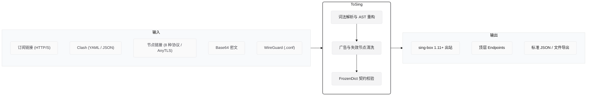
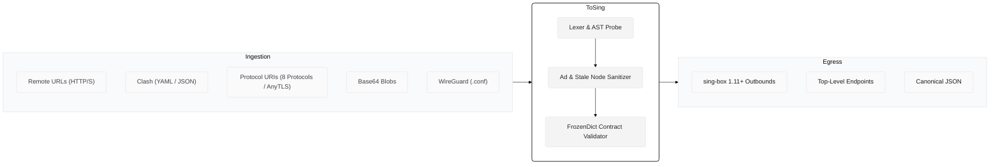

  

<h1 align="center">ToSing</h1>

  sing-box 订阅解析与节点聚合工具

  
  
  
  
  
  

  <a href="#中文">中文</a> &nbsp;|&nbsp; <a href="#english">English</a>

---

## 中文

### 架构

### 原理
- **无状态**：全内存处理，无本地数据库与网络状态依赖。
- **AST 解构**：统一将各类格式映射为标准协议模型。
- **O(1) 校验**：基于 `FrozenDictionary` 索引官方 Schema 验证字段。

### 技术栈
| 模块 | 技术 | 说明 |
| :--- | :--- | :--- |
| **运行时** | C# 15 / .NET 11 | 纯内存流处理 |
| **二进制** | Native AOT | 单文件可执行程序 (~10.6MB，无运行库依赖) |
| **界面** | Avalonia 12.1.2 | Windows 11 Fluent 桌面端 |
| **序列化** | `System.Text.Json` | 源码生成模式（Source Generator） |

### 测试数据
基于 36 个异构数据源的回放验证：
- **测试样本**：`301,513`
- **解析成功**：`245,717`
- **sing-box 内核校验通过**：`245,708`
- **对齐通过率**：**`99.996%`**

### 内核对齐
严格对齐 **`sing-box 1.11+`**（含 WireGuard 顶层 `endpoints` 与双栈 CIDR），持续跟进官方内核更新。

---

## English

### Pipeline

### Design
- **Stateless**: In-memory execution without external database or state leakage.
- **AST Mapping**: Deconstructs heterogeneous sources into uniform protocol models.
- **O(1) Validation**: `FrozenDictionary` indexed schemas for schema compliance checks.

### Tech Stack
| Component | Technology | Detail |
| :--- | :--- | :--- |
| **Runtime** | C# 15 / .NET 11 | In-memory stream processing |
| **Binary** | Native AOT | Single-file executable (~10.6MB, zero runtime dependencies) |
| **Desktop UI** | Avalonia 12.1.2 | Windows 11 Fluent desktop app |
| **Serialization** | `System.Text.Json` | Source generator mode |

### Test Corpus
Verified against a real-world corpus across 36 heterogeneous sources:
- **Total Records**: `301,513`
- **Parsed**: `245,717`
- **Kernel Verified**: `245,708`
- **Pass Rate**: **`99.996%`**

### Upstream
Built against **`sing-box 1.11+`** (including top-level `endpoints` & dual-stack CIDRs). Continuously synchronized with upstream releases.
